# da-learn-20 · World happiness vs GDP per capita

A data-analyst learning project on the **World Happiness Report** data (Gallup World Poll life evaluations, 2024 edition) joined to **World Bank GDP and population**. The WHR yearly panel covers **165 countries × survey years 2005-2023 = 2,363 country-years**, with the life ladder (0-10 Cantril ladder) and the six WHR factors (log GDP per capita, social support, healthy life expectancy, freedom, generosity, perceived corruption) plus positive and negative affect. It is joined by a hand-checked country crosswalk to World Bank GDP (current US$) and population to get GDP per capita in dollars. The raw files go through SQL staging, cleaning (types, encoding fix, name standardisation, region fallback, World Bank crosswalk, range checks), a star schema, analysis (income vs happiness, drivers, regions, over/under-performers, change over time, pandemic shift) and quality checks. DuckDB runs the whole pipeline locally on the **full** data. The outputs are a Power BI kit plus SVG and PNG charts in `results/images/`.

> **Databricks was skipped** for this project because the Databricks workspace hit its resource quota. There is no live Lakeview dashboard. The SQL stays Databricks/Spark-compatible (the DuckDB shims are isolated in `sql/00`), and all charts and KPIs are in [`results/`](results/RESULTS.md).

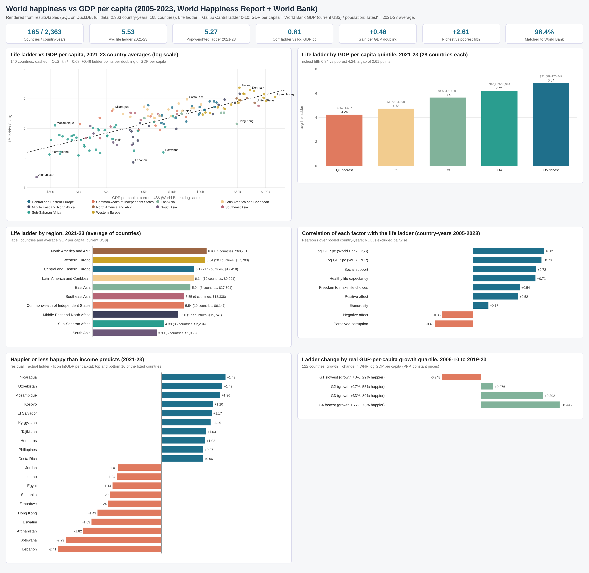

## Business questions
1. How strongly does national income go with life evaluations, and is the link linear or logarithmic?
2. Besides income, which factors move most with happiness (social support, health, freedom, corruption, generosity)?
3. Which regions and countries are happiest, and which are much happier or unhappier than their income predicts?
4. Did countries whose economies grew faster between 2006-10 and 2019-23 become happier (an Easterlin-paradox check)?
5. Did the 2020-22 pandemic years change life evaluations and emotions?
6. How clean is the join between the WHR country list and World Bank data, and what is missing?

## Pipeline
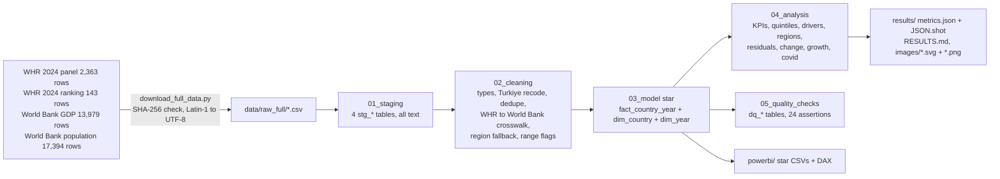

## Headline insights (full data: 2,363 country-years, 165 countries; "latest" = 2021-23 country averages, 143 countries)
1. **Happiness rises with the log of income.** The life ladder correlates **0.81** with log GDP per capita (only 0.70 with GDP in dollars). In 2021-23, log GDP per capita explains **68%** of cross-country differences and each **doubling of income goes with +0.46 ladder points**. The richest fifth of countries average **6.84** vs **4.24** for the poorest fifth.
2. **Social support (0.72) and healthy life expectancy (0.71) track happiness almost as closely as income**; freedom 0.54, perceived corruption -0.43, generosity only 0.18. The richest quintile differs from the next one mainly on low perceived corruption (0.459 vs 0.788), not social support (0.897 vs 0.887).
3. **Income is not destiny.** Nicaragua ($2,356 per head) is **+1.49** ladder points above the income fit, Uzbekistan +1.42, Mozambique +1.36; Lebanon (-2.41), Botswana (-2.23) and Afghanistan (-1.82) are far below it. In 2023 Costa Rica is #4 (7.38) at $16,942 per head, a third of #1 Finland's $53,759 (7.70).
4. **Faster growth went with rising happiness.** Between 2006-10 and 2019-23 (122 countries), the slowest-growing quartile (+0.4% real GDP per capita) lost **-0.25** ladder points while the fastest (+66.2%) gained **+0.49**; 73% vs 29% of countries got happier. Exceptions matter: India grew +79.9% and fell -1.08.
5. **The pandemic barely moved life evaluations:** for the same 143 countries the ladder went from 5.55 (2017-19) to 5.50 (2020-22), while negative affect rose +0.013 and generosity +0.044.

Full tables, six insights and the data-quality evidence are in [`results/RESULTS.md`](results/RESULTS.md).

## Charts
All charts are in `results/images/` as SVG (plain vector shapes, no embedded raster) and PNG (2× headless-Chrome render of the same SVG).

| | |
|---|---|
| 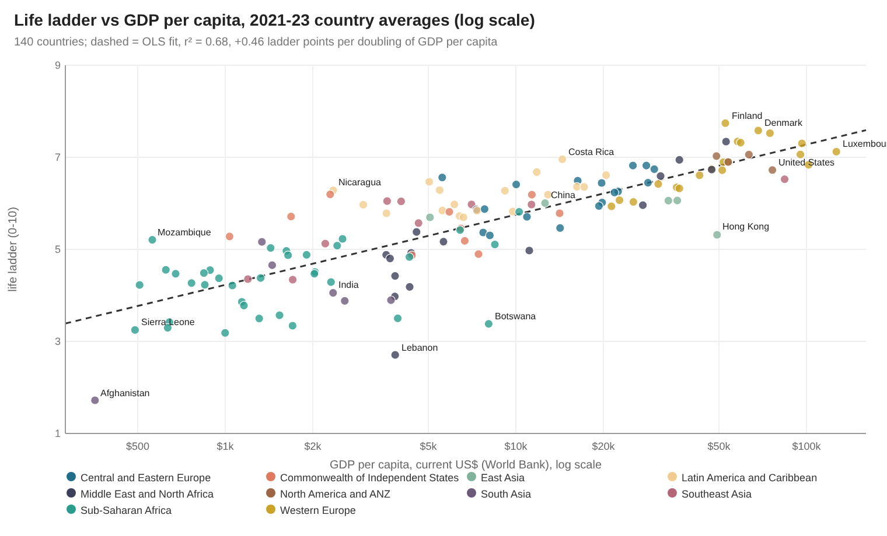 | 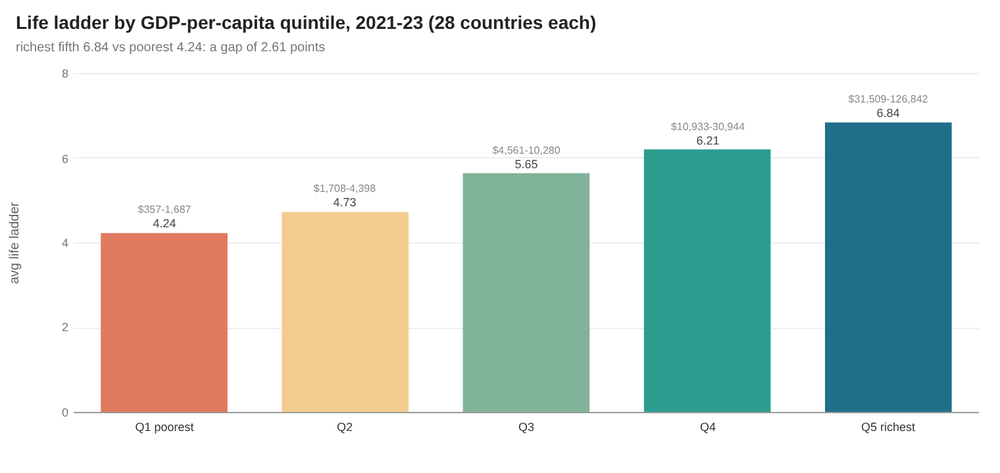 |
| 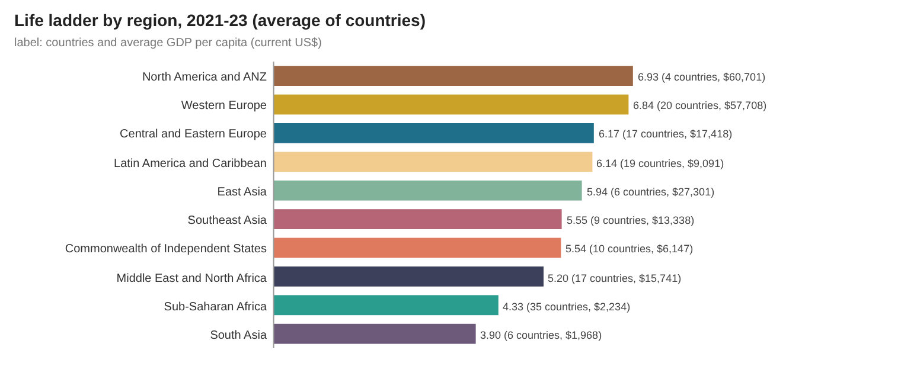 | 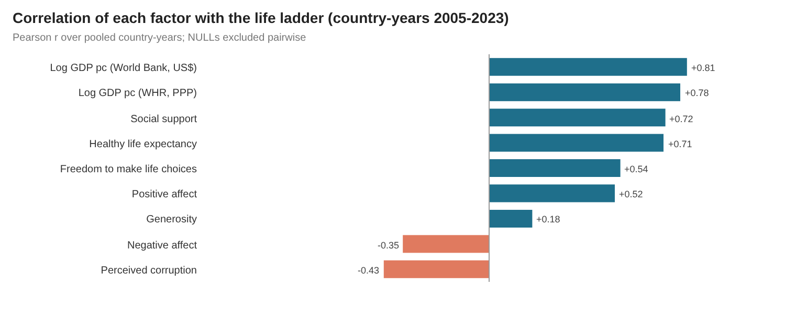 |
| 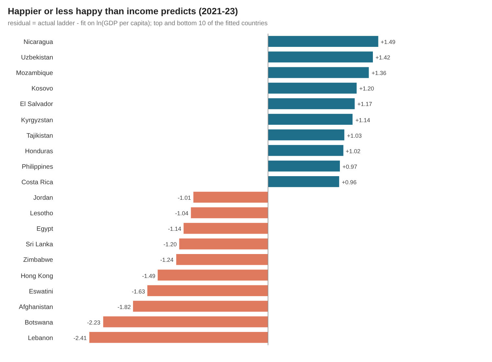 | 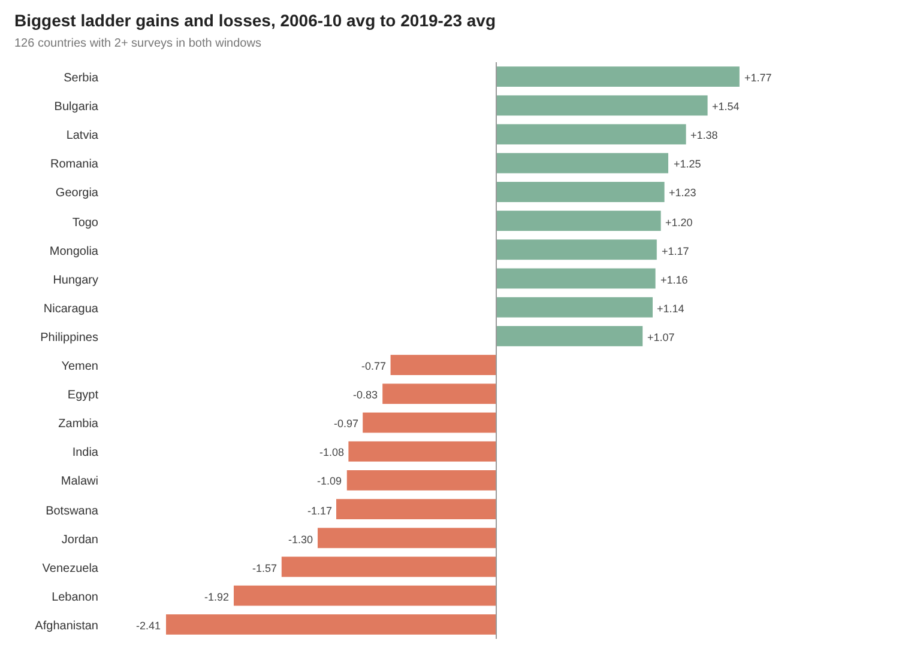 |
| 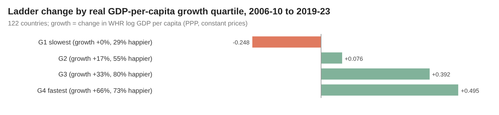 | 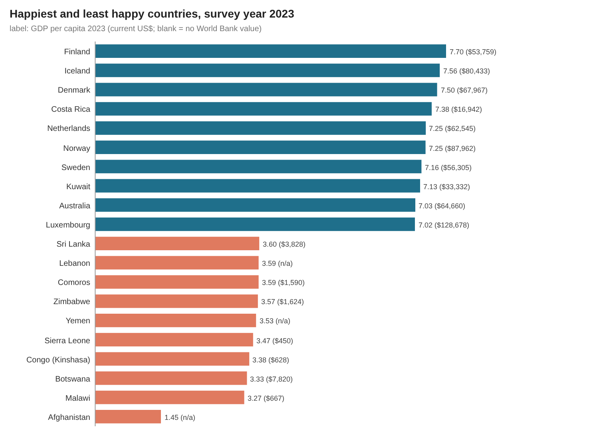 |
| 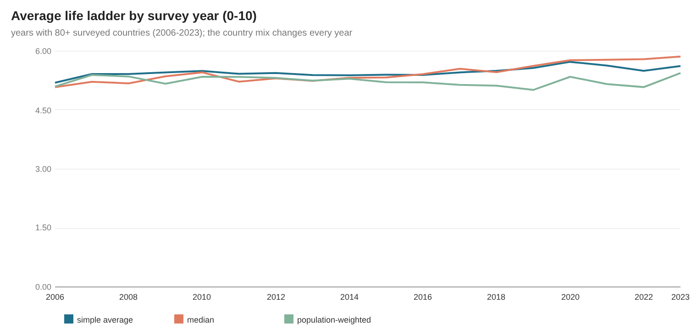 | 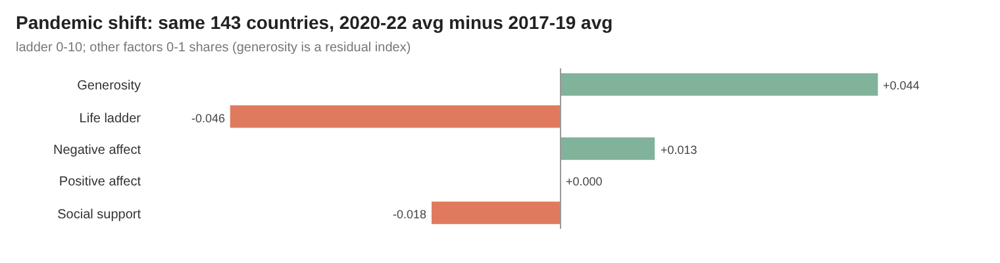 |
| 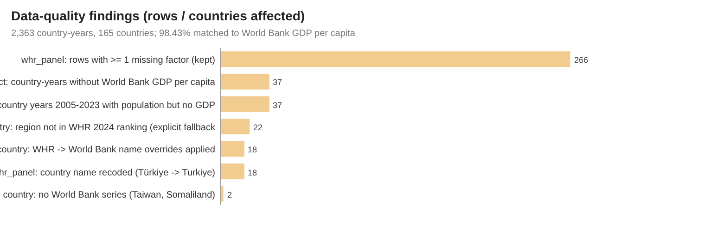 | |

## How to run
```bash
pip install -r requirements.txt
python run_pipeline.py --source sample       # committed 12-country raw sample in data/raw/, results in results/sample/
python scripts/download_full_data.py         # 4 CSVs, 1.3 MB -> data/raw_full/ (SHA-256 checked)
python run_pipeline.py --source full         # full data (~1 s): results/, data/clean/, powerbi/data/, RESULTS.md
python scripts/render_png.py                 # results/images/*.svg -> *.png with headless Chrome
```
`scripts/make_sample.py` rebuilds the committed sample from the full files. The runner stops with an error if any assertion fails.

## Method notes
- **Life ladder** is the national average answer to "imagine a ladder from 0 (worst possible life) to 10 (best possible life)"; social support, freedom, corruption and the affect measures are national shares (0-1); generosity is the WHR residual of donating on GDP (can be negative).
- **GDP per capita** = World Bank GDP (current US$, NY.GDP.MKTP.CD) / World Bank population (SP.POP.TOTL) for the same calendar year. The WHR's own `Log GDP per capita` (PPP, constant international $) is kept alongside and used for the **real growth** comparison in Q9, because current-dollar GDP mixes in inflation and exchange-rate moves. The two log-GDP measures correlate strongly (assertion: r ≥ 0.9).
- **Crosswalk:** WHR country names are matched to World Bank names with 18 explicit overrides (e.g. `Congo (Kinshasa)` → `Congo, Dem. Rep.`, `South Korea` → `Korea, Rep.`, `State of Palestine` → `West Bank and Gaza`) and `Türkiye` recoded to `Turkiye`, then mapped to ISO3. Only Taiwan and Somaliland have no World Bank series. 37 country-years (1.57%) have no World Bank GDP per capita: Taiwan (16) and Somaliland (4) have no series at all, plus Venezuela 2015-23 (9), Yemen (3), South Sudan (2) and one year each for Lebanon, Kosovo and Afghanistan. They stay in the fact table with `dq_no_gdp_pc = 1` and are left out of GDP calculations.
- **Regions** come from the WHR 2024 `Regional indicator`; the 22 panel countries not in the 2024 ranking get the WHR region explicitly in `02_cleaning.sql`.
- **Missing factors** (266 country-years with at least one missing WHR factor) are kept as NULL and excluded pairwise from averages and correlations; nothing is imputed.
- **Windows:** "latest" = 2021-23 country averages (the same window the WHR 2024 ranking uses); change = 2006-10 vs 2019-23 averages for countries with 2+ surveys in each window; pandemic = 2017-19 vs 2020-22 for the same countries.
- Year-by-year averages mix real change with changes in which countries were surveyed (2005 has only 27, mostly rich, countries), so the trend chart starts at 2006 and the change analysis uses matched countries.

## Repo layout
```
data/raw/            deterministic 12-country sample of the four raw files (27 KB); full files via scripts/download_full_data.py
data/clean/          full cleaned star (star/*.csv) + country_crosswalk.csv (small enough to commit)
sql/                 00 DuckDB shims, 01 staging, 02 cleaning, 03 star model, 04 analysis, 05 quality checks
run_pipeline.py      DuckDB runner (sample | full)
scripts/             project config, downloader, sample builder, SVG chart writer, PNG renderer, RESULTS.md writer
results/             RESULTS.md, metrics.json, JSON.shot, tables/*.csv, images/*.svg + *.png (dashboard = overview), sample/
powerbi/             full star CSVs, measures.dax, model.md, dashboard_spec.md, BUILD_GUIDE.md
```

## Caveats
- **Correlation, not causation.** Cross-country links between income and happiness do not show that raising GDP raises happiness; health, institutions and social ties all rise with income.
- **Country averages, not people.** Unless stated (population-weighted ladder), each country counts once: Iceland weighs as much as India.
- **Survey noise.** Gallup samples about 1,000 people per country-year, so single-year moves of ±0.1-0.2 are within sampling error; the 2024 ranking file carries the WHR's own confidence whiskers.
- **Current dollars** make GDP per capita sensitive to exchange rates; the PPP-based WHR measure is used for growth.
- The 2020-21 surveys in some countries moved from face-to-face to phone interviews, which may affect comparability.

## Complete dataset
- **Source:** World Happiness Report 2024 (Helliwell, J. F., Layard, R., Sachs, J. D., De Neve, J.-E., Aknin, L. B. & Wang, S., eds.; Wellbeing Research Centre, University of Oxford; data from the Gallup World Poll), https://worldhappiness.report/ed/2024/ ("Data for Figure 2.1" and the yearly panel "Data for Table 2.1"). World Bank World Development Indicators: GDP (current US$) https://data.worldbank.org/indicator/NY.GDP.MKTP.CD and population https://data.worldbank.org/indicator/SP.POP.TOTL.
- **Kaggle page:** https://www.kaggle.com/datasets/jainaru/world-happiness-report-2024-yearly-updated (two CSVs, 179,612 B, licence on Kaggle: CC0 Public Domain).
- **Mirrors used (exact URLs, pinned commits):**
  - https://raw.githubusercontent.com/semypak/data/3c7201660c4985d2ec5b232563126049d95449b0/World-happiness-report-updated_2024.csv (unmodified copy of the Kaggle file, same byte size)
  - https://raw.githubusercontent.com/semypak/data/3c7201660c4985d2ec5b232563126049d95449b0/World-happiness-report-2024.csv
  - https://raw.githubusercontent.com/datasets/gdp/36d761dc5617982d3e50b213e02b9a1b47c4e958/data/gdp.csv (https://github.com/datasets/gdp, Frictionless Data package of World Bank NY.GDP.MKTP.CD)
  - https://raw.githubusercontent.com/datasets/population/d4b1a4a9a17e2123baf0ef119de05bceced1ab1b/data/population.csv (https://github.com/datasets/population, World Bank SP.POP.TOTL)
- **Licence:** WHR files: CC0 1.0 Public Domain as published on Kaggle (cite the World Happiness Report and Gallup World Poll). World Bank data: CC BY 4.0 (World Bank terms of use); the `datasets/gdp` package is CC BY 4.0 and `datasets/population` is ODC-PDDL 1.0.
- **Total size:** 1,299,097 bytes in 4 CSVs (original bytes, SHA-256 verified by the downloader).
- **Files:**
  - `World-happiness-report-updated_2024.csv`: 166,307 B, 2,363 rows × 11 columns (`Country name, year, Life Ladder, Log GDP per capita, Social support, Healthy life expectancy at birth, Freedom to make life choices, Generosity, Perceptions of corruption, Positive affect, Negative affect`), 165 countries, 2005-2023; Latin-1 encoded (re-encoded to UTF-8 on download), SHA-256 `2125094682ab2777e00135a705a26b0ce75972867447b455ea453063e70ebe2b`.
  - `World-happiness-report-2024.csv`: 13,305 B, 143 rows × 12 columns (`Country name, Regional indicator, Ladder score, upperwhisker, lowerwhisker, Log GDP per capita, Social support, Healthy life expectancy, Freedom to make life choices, Generosity, Perceptions of corruption, Dystopia + residual`), SHA-256 `0539aaa1984b903f6750ace8e265e54e30ea52f9f92fade118010fc2fc379de0`.
  - `gdp.csv`: 562,767 B, 13,979 rows × 4 columns (`Country Name, Country Code, Year, Value`), 262 countries/aggregates, 1960-2023, SHA-256 `8d84ef6bcaccf740c01c5ed7566aae8f7b149d0e2c20001e441efd3cb5b2fa86`.
  - `population.csv`: 556,718 B, 17,394 rows × 4 columns (`Country Name, Country Code, Year, Value`), 264 countries/aggregates, 1960-2025, SHA-256 `2c697c3e668c8cb06ee467cd0d475b37b52844fdc48cb7725b79b58f18bf0b02`.
- **Download:** `python scripts/download_full_data.py` (downloads the four mirror files into `data/raw_full/` and verifies SHA-256).
