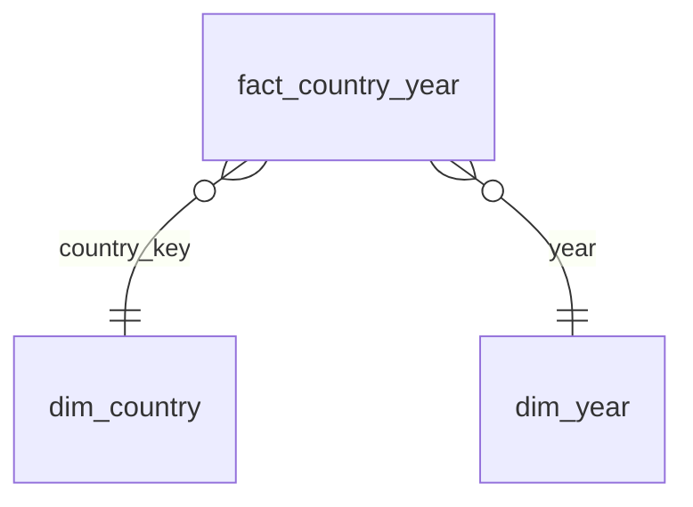

# Power BI model (star schema)

| Table | Grain | Rows (full = committed) | Key |
|---|---|---|---|
| fact_country_year | one WHR country x survey year (Gallup World Poll national averages + World Bank GDP and population of that year) | 2,363 | (country_key, year) |
| dim_country | WHR country: ISO3, World Bank name, WHR region, WHR 2024 ladder score and rank, first/last survey year | 165 | country_key |
| dim_year | survey year 2005-2023, period bucket, COVID-years flag (2020-22) | 19 | year |

The whole star is small, so `powerbi/data/` holds the **full** tables (no sampling).

Relationships: both many-to-one, single direction (dimension filters fact): `fact_country_year[country_key]` → `dim_country[country_key]`, `fact_country_year[year]` → `dim_year[year]`.

Fact columns worth knowing:
- `life_ladder` (0-10 Cantril ladder, national average), `social_support`, `freedom`, `corruption`, `positive_affect`, `negative_affect` (0-1 shares), `healthy_life_exp` (years), `generosity` (WHR residual index, can be negative), `whr_log_gdp_pc` (WHR log GDP per capita, PPP constant prices).
- `gdp_usd`, `population`, `gdp_pc_usd` (World Bank, current US$), `ln_gdp_pc_usd`, `gdp_pc_band` (text band, sort by itself: prefixed `1:`..`5:`).
- `dq_*` flags: `dq_missing_factors` (count of missing WHR factors, kept), `dq_no_gdp_pc` (1 = no World Bank GDP per capita for that year).
- Averages of ratio columns should be **simple averages of countries** (as in the WHR); use the population-weighted measure when you want "average person".
